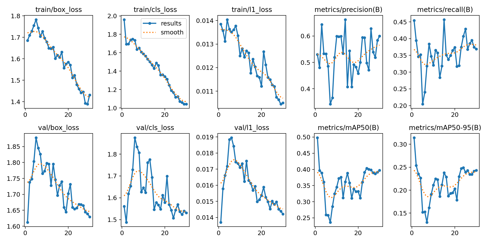
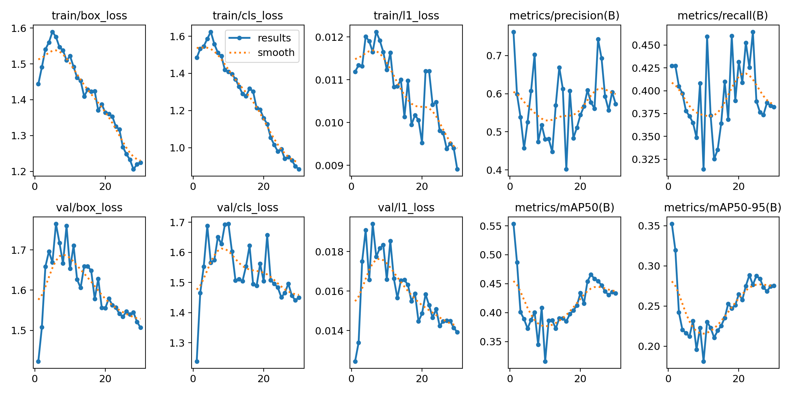
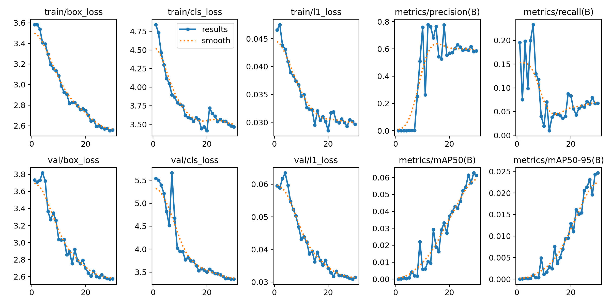

# Pj1 RET503: Sistem Persepsi untuk Pemantauan Ruangan Berbasis IoT dan BMS

| | |
|---|---|
| Nama | DZAKI TAUFIQURRAHMAN |
| NIM | 4222411060 |
| Sidik jari dataset | `0186E075846E` |
| Lingkungan | Google Colab, GPU Tesla T4, Ultralytics 8.4.188, model YOLO26n |

Projek saya saat ini berada di tahap desain. Sistem belum dibangun, sehingga hubungan antara hasil deteksi dan fungsi BMS pada bagian 1 masih berupa rancangan. Percobaan di README ini memakai dataset COCO sebagai langkah awal untuk menguji pipeline deteksi objek.

---

## 1. Lingkup persepsi

Projek saya adalah sistem pemantauan ruangan berbasis IoT yang terhubung dengan Building Management System (BMS). Sistem ini memadukan RFID, computer vision, dan sensor IoT, dengan laboratorium kampus (ruang solder atau ruang mekanik) sebagai lokasi uji. RFID mencatat identitas orang yang masuk, sedangkan kamera RGB dengan YOLO dipakai untuk menjawab dua hal: objek apa yang ada di dalam ruangan, dan berapa jumlahnya. Hasil deteksi dikirim lewat IoT ke BMS untuk mengatur lampu, menghitung biaya listrik per hari dan per bulan, serta mengontrol listrik di satu ruangan. Jumlah orang dari kamera juga dapat dibandingkan dengan jumlah tap RFID untuk mengecek kecocokan data.

Ada empat kelas yang saya pilih. Pilihan ini dibatasi oleh dua hal: objeknya harus ada di laboratorium tersebut dan harus tersedia di COCO.

| class_id | Kelas | Alasan untuk sistem |
|---|---|---|
| 0 | person | Jumlah orang menentukan beban AC dan lampu, dan bisa dicocokkan dengan jumlah tap RFID |
| 1 | chair | Menunjukkan kursi terisi atau kosong untuk memperkirakan okupansi ruangan |
| 2 | dining table | Pendekatan untuk meja kerja lab (COCO tidak punya kelas workbench), menandai area kerja yang sedang dipakai |
| 3 | couch | Menandai area duduk atau tunggu, ikut menentukan okupansi ruangan |

Objek yang tidak ada di COCO, seperti kartu RFID, rencananya akan dibuat sebagai dataset tambahan.

---

## 2. Dataset (Tahap 1 dan 2)

Dataset diambil dari COCO val2017 memakai `00_ambil_subset_coco.py` dengan kelas person, chair, dining table, dan couch. Saya mengambil 600 gambar berobjek dan 60 gambar latar tanpa objek, total 660 gambar dengan 2740 kotak.

| Kelas | Jumlah kotak |
|---|---|
| person | 2051 |
| chair | 454 |
| dining table | 168 |
| couch | 67 |

Hasil pemeriksaan anotasi dengan `01_cek_anotasi.py`:

- Tidak ada gambar yang kehilangan file label.
- Ada 60 label kosong, yaitu gambar latar yang memang tanpa objek.
- Ada 176 peringatan. Skrip hanya menampilkan 20 baris pertama, dan semuanya bertipe "kotak sangat kecil" (sekitar 4 sampai 44 piksel). Karena pemeriksaan lain (file label hilang, format salah, class_id di luar rentang) hasilnya 0, saya menyimpulkan 176 peringatan itu juga bertipe kotak kecil, umumnya objek yang jauh atau kecil di latar gambar. Saya tidak menghapusnya karena objek kecil memang akan ditemui kamera di ruangan.
- Pemeriksaan format memberi hasil 0 baris salah.
- Cek visual: saya memeriksa 3 gambar dari folder `cek_visual`. Ketiganya berisi kelas person (pemain skateboard, pejalan kaki berpayung, dan pria di samping motor), dan kotaknya pas mengelilingi tubuh orang tanpa tertukar dengan objek lain. Ketiga gambar tidak memuat chair, dining table, atau couch, sehingga pemeriksaan visual saya belum mencakup tiga kelas itu. Gambarnya juga foto luar ruangan, bukan ruang lab.

Konversi YOLO ke COCO lalu kembali ke YOLO diuji pada 660 file label, dan tidak ada satu pun yang berubah (0 file berbeda).

Pembagian data memakai `05_split_dataset_yolo.py` dengan proporsi 70/20/10:

| Bagian | Gambar | Kotak | person | chair | dining table | couch |
|---|---|---|---|---|---|---|
| train | 461 | 1901 | 1425 | 301 | 127 | 48 |
| val | 132 | 537 | 439 | 66 | 21 | 11 |
| test | 67 | 302 | 187 | 87 | 20 | 8 |

Data ini tidak seimbang. Person mendominasi, sedangkan couch hanya 11 kotak di val dan 8 di test, sehingga hasil kelas couch harus dibaca dengan hati-hati.

---

## 3. Hasil eksperimen (Tahap 3 sampai 5)

Semua eksperimen memakai pengaturan yang sama: epochs 30, imgsz 416, batch 16, dan seed 0. Satu-satunya perubahan ada di E3, yaitu imgsz menjadi 640.

| Eksperimen | Perubahan | mAP50 | mAP50-95 | P | R | ms/gambar | Menit latih |
|---|---|---|---|---|---|---|---|
| E1_pretrained | baseline | 0,490 | 0,307 | 0,534 | 0,451 | 4,9 | 3,9 |
| E2_scratch | bobot acak | 0,061 | 0,025 | 0,591 | 0,067 | 3,0 | 3,6 |
| E3_tuning | imgsz=640 | 0,555 | 0,352 | 0,719 | 0,440 | 6,9 | 4,6 |

Model terpilih adalah E3, karena mAP50-95 di data val paling tinggi. Model ini diuji satu kali di data test dan mendapat mAP50 0,475, mAP50-95 0,282, presisi 0,469, dan recall 0,423.

Epoch dengan mAP50-95 val tertinggi: E1 epoch 1 (0,314), E2 epoch 30 (0,025), E3 epoch 1 (0,352). Artinya `best.pt` E1 dan E3 adalah checkpoint epoch 1 (lihat bagian 4c).

Karena itu saya menambahkan evaluasi E1 pada resolusi 640 dan hasil per kelas. Semuanya dihitung pada data val, nilainya mAP50-95:

| Kelas | Kotak di val | E1 @416 | E1 @640 | E3 @640 |
|---|---|---|---|---|
| person | 439 | 0,368 | 0,421 | 0,450 |
| chair | 66 | 0,239 | 0,226 | 0,280 |
| dining table | 21 | 0,312 | 0,317 | 0,358 |
| couch | 11 | 0,310 | 0,315 | 0,321 |
| semua | 537 | 0,307 | 0,320 | 0,352 |

### Grafik pelatihan

E1_pretrained

E3_tuning

E2_scratch

---

## 4. Analisis

### a. Transfer learning (E1 dan E2)

E1 mencapai mAP50-95 0,307, sedangkan E2 hanya 0,025. Recall E2 cuma 0,067, artinya hanya sekitar 7% objek yang berhasil ditemukan. Presisi E2 memang tinggi (0,591), tetapi itu karena modelnya hampir tidak membuat prediksi, jadi angka tersebut tidak bisa dibaca sebagai hasil yang baik. Di log pelatihan, mAP50-95 E2 masih naik sampai epoch 30 (0,025) dan loss masih turun, jadi model ini belum selesai belajar. Dengan 461 gambar latih dan 30 epoch, belajar dari nol belum cukup.

E1 membawa bobot hasil latihan di COCO. Keempat kelas saya ada di COCO, sehingga wajar kalau E1 sudah bisa mengenali objeknya sejak awal. Keunggulan E1 lebih banyak datang dari pengetahuan COCO yang sudah ada daripada dari proses fine-tuning, dan ini berlaku untuk data dan jumlah epoch yang saya pakai.

### b. Pengaruh perubahan imgsz=640 (E1 dan E3)

Dengan imgsz 640, mAP50-95 naik dari 0,307 menjadi 0,352. Harganya, waktu inferensi naik dari 4,9 ke 6,9 ms (sekitar 41% lebih lama) dan waktu latih naik dari 3,9 ke 4,6 menit.

Supaya tahu dari mana kenaikan itu berasal, saya mengevaluasi model E1 pada resolusi 640 juga, dan hasilnya 0,320. Jadi sekitar 0,013 dari kenaikan datang dari resolusi saat evaluasi, dan sisanya sekitar 0,032 datang dari pelatihan pada 640. Kenaikan ini terutama datang dari presisi (0,514 pada E1@640 menjadi 0,719 pada E3), sedangkan recall justru turun (0,529 menjadi 0,440). Kelas person naik paling jelas, dari 0,368 (E1@416) menjadi 0,450 (E3).

Hasil ini perlu dibaca hati-hati. `best.pt` E3 adalah checkpoint epoch 1, sehingga efek "pelatihan di 640" di sini sebenarnya hanya satu epoch fine-tuning dari bobot COCO. Selain itu saya hanya menjalankan satu kali dengan satu seed, dan data val hanya 132 gambar, sehingga selisih 0,045 antara E1 dan E3 bisa saja masih termasuk fluktuasi biasa.

### c. Kurva pelatihan

Pada E1 dan E3, loss pelatihan turun hampir terus sampai epoch 30 (box loss E3 dari 1,44 ke 1,22). Tetapi performa di data val tidak mengikutinya. mAP50-95 val tertinggi justru ada di epoch 1 (E1 0,314 dan E3 0,352), lalu turun sampai titik terendah (E1 0,130 di epoch 7, E3 0,181 di epoch 10), dan baru naik lagi menjelang akhir (E1 0,243 dan E3 0,275 di epoch 30). Akibatnya `best.pt` E1 dan E3 adalah checkpoint epoch 1.

Loss validasi juga naik di awal. Pada E3, box loss val naik dari 1,42 ke 1,77 di epoch 6, dan cls loss val naik dari 1,24 ke 1,69 di epoch 10, sebelum turun lagi. Pada E1, box loss val naik dari 1,61 ke 1,88 di epoch 5.

Dugaan saya, di fase awal fine-tuning bobot dari COCO sempat bergeser, sehingga model butuh waktu untuk pulih. Saya belum menguji penyebabnya, jadi ini baru dugaan. Kenaikan mAP setelah sekitar epoch 20 terjadi bersamaan dengan berhentinya augmentasi mosaic (mulai epoch 21), dan kurva E3 masih naik-turun di akhir. Grafik presisi dan recall sangat bergerigi karena data val kecil.

### d. Perbandingan antarkelas

Pada E3, person punya hasil tertinggi (mAP50-95 0,450) dan chair terendah (0,280, dengan recall 0,364). Chair menarik karena kotaknya cukup banyak (66 di val dan 301 di train), sehingga rendahnya bukan semata karena data kurang. Dugaan saya, kursi sering tertutup objek lain atau terpotong tepi gambar, dan bentuknya sangat beragam. Hal ini penting untuk sistem saya karena kursi dipakai untuk memperkirakan okupansi ruangan.

Hasil dining table (21 kotak di val) dan couch (11 kotak) tidak bisa ditafsirkan terlalu jauh. Contohnya, recall couch naik dari 0,455 (E1@416) menjadi 0,636 (E1@640), padahal selisih itu hanya sekitar 2 kotak dari 11.

### e. Hasil test

Di data test, E3 mendapat mAP50-95 0,282, lebih rendah dari nilai val (0,352). Ada dua kemungkinan penyebab. Pertama, data test hanya 67 gambar dan 302 kotak (couch hanya 8 kotak), sehingga angkanya mudah bergeser. Kedua, model dipilih berdasarkan nilai val, sehingga val cenderung lebih optimis. Saya belum menguji kedua kemungkinan ini.

---

## 5. Kesimpulan

1. Transfer learning sangat membantu. Pada data dan jumlah epoch yang sama, E1 mencapai mAP50-95 0,307 sedangkan E2 hanya 0,025.
2. Melatih pada imgsz 640 menaikkan mAP50-95 menjadi 0,352, terutama lewat presisi, dengan waktu inferensi sekitar 41% lebih lama.
3. Fine-tuning 30 epoch belum menghasilkan model yang lebih baik daripada checkpoint epoch 1. Kemungkinan penyebabnya adalah keempat kelas sudah dikenal model COCO. Chair adalah kelas yang paling sulit.

Keterbatasan percobaan ini:

- Hanya satu kali percobaan dengan satu seed.
- Data val dan test kecil, dan kelas couch sangat sedikit.
- Gambar COCO berbeda dari gambar yang akan diambil kamera di lokasi uji.
- Kelas couch dipilih karena tersedia di COCO dan kemungkinan kurang relevan di ruang lab. Kelas dining table hanyalah pendekatan untuk meja kerja lab.
- Kecepatan baru diukur di GPU Colab, belum di perangkat yang akan dipakai sistem.

Langkah berikutnya, dengan prinsip satu perubahan per eksperimen:

- E4: menambah epochs atau mengganti optimizer, untuk menguji dugaan bobot COCO bergeser di awal pelatihan.
- Mengumpulkan dataset dari kamera di lokasi uji, termasuk objek yang tidak ada di COCO seperti kartu RFID, lalu melatih ulang model.
- Mengukur kecepatan di perangkat yang benar-benar dipakai sistem.

## Referensi

- Lin, T.-Y., dkk. (2014). *Microsoft COCO: Common Objects in Context*. arXiv:1405.0312.
- Ultralytics Docs, "COCO Dataset".
